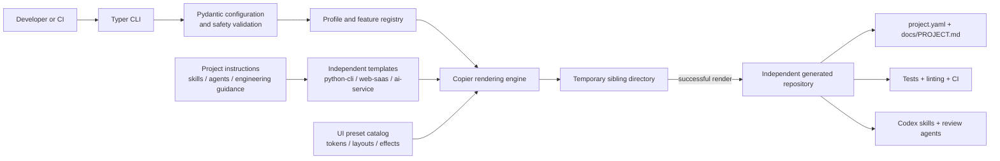

# Architecture

AI Project Factory is a deterministic local generator. It validates a small project contract, selects one independent Copier template, renders into a temporary sibling directory, and only then moves the completed output to its requested destination.

## Boundaries

### Factory runtime

- `src/project_factory/config.py` owns the validated project schema and feature compatibility rules.
- `src/project_factory/validation.py` rejects unsafe names, unsupported profiles, and existing destinations.
- `src/project_factory/generator.py` maps validated configuration into a selected Copier template and performs staged generation.
- `src/project_factory/cli.py` provides interactive and non-interactive entry points without embedding generation policy.
- `src/project_factory/design.py` owns UI style, layout, theme, effect, and accessibility validation.

### Template runtime

Each directory under `templates/` is independently usable by Copier and produces an independently runnable project. Templates do not import the factory at application runtime. Generated repositories retain `.copier-answers.yml` so an update can be reviewed against a versioned template later.

### Generated-project contract

`project.yaml` is the machine-readable selection record. `docs/PROJECT.md` contains the human requirements and acceptance criteria. Architecture, decisions, tasks, and changelog files are derived engineering records. If the structured and human requirements conflict, the generated instructions require the developer or agent to report the conflict rather than guess.

## Trust and safety properties

- Generation requires a destination that does not already exist.
- Rendering occurs in a temporary sibling directory, avoiding partial output at the requested path.
- Unknown configuration fields and incompatible features fail validation.
- Default tests use no cloud credentials, production database, or live model.
- External provider credentials are read from environment variables and providers initialize lazily.
- CI validates the factory, representative generated applications, the UI gallery contract, and tracked files for likely secrets.

These properties reduce common scaffolding risks; they do not make a generated application production-ready. Authentication, authorization, data retention, availability targets, infrastructure hardening, and provider-specific threat models must be defined and verified in the generated project.

## Extension rules

Add a profile only when a distinct architecture repeats across projects. Add a feature only when its compatibility rules and generated behavior can be tested. Application-specific integrations should remain in the generated repository instead of expanding the factory prematurely.

